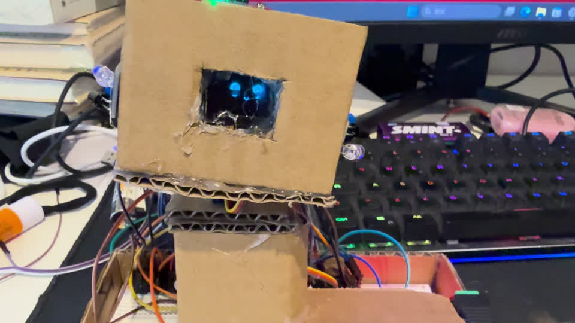

# PaperRobot V2 纸板陪伴机器人
INNNX. 制作，灵感来自 **Made by Z**。V2 仍属于改造项目，不能仅凭版本号宣称完全独立原创。

[English](README.md) | [Español](README.es.md)

## 已在实际源码实现的功能
六种脸部设计：正常、开心、眨眼、好奇、害羞、睡眠；可爱实心眼睛、平滑表情切换和眨眼。左右红外感应时，眼睛、嘴巴以及脸部装饰整体同步平移，并控制头部 yaw；两侧同时有效则回中。触摸触发开心表情和一次 pitch 点头。舵机有限幅、限速；OLED 失败后会重试。

这是源码核对结果，编译结果见 [编译与实物记录](docs/zh-CN/TESTING.md)。本次整理未进行实物测试；用户表示制作完成，已提供下方真实演示视频；独立成品照片及逐项实物测试记录仍待补充。

## 硬件与制作
ESP32-C3 SuperMini；SSD1306 128×64，0x3C，SDA GPIO0/SCL GPIO1；SG90 两个，Yaw GPIO4/Pitch GPIO5；左右红外 GPIO6/7；TTP223 GPIO10。UBEC 输出 5V 给舵机，所有设备共地。**12V 适配器仅接 UBEC 输入**。保留现有大面包板。

外壳用 **3mm 瓦楞纸板，按实物手工测量裁切**。实际没有使用纸模板，不提供纸板裁切 PDF。尺寸、胶合位置和真实制作照片待用户补充，不编造。

先阅读 [安全](docs/zh-CN/SAFETY.md)、[接线](docs/zh-CN/WIRING.md)，逐项运行 [独立测试程序](docs/zh-CN/COMPONENT-TESTS.md)，再按 [组装步骤](docs/zh-CN/ASSEMBLY.md) 安装，使用 [固件说明](docs/zh-CN/FIRMWARE.md) 上传 [完整 V2 源码](firmware/PaperRobotV2/PaperRobotV2.ino)。首次舵机测试先拆下舵盘。

## 完整资料
[配件清单](docs/zh-CN/BOM.md) · [接线说明](docs/zh-CN/WIRING.md) · [制作与组装](docs/zh-CN/ASSEMBLY.md) · [配件测试与源码](docs/zh-CN/COMPONENT-TESTS.md) · [固件与功能](docs/zh-CN/FIRMWARE.md) · [故障排查](docs/zh-CN/TROUBLESHOOTING.md) · [安全注意事项](docs/zh-CN/SAFETY.md) · [编译与实物记录](docs/zh-CN/TESTING.md) · [致谢与差异](docs/zh-CN/ATTRIBUTION.md) · [版本历史](docs/zh-CN/CHANGELOG.md) · [许可证合规](docs/zh-CN/LICENSE-REVIEW.md)

## 真实素材预留
- 成品照片：待真实照片链接。
- [观看／下载真实演示视频](https://github.com/Lq922466/esp32-companion-v1/raw/refs/heads/main/media/PaperRobotV2-demo.mp4)：约 74 秒，由用户提供的 IMG_3257.mov 转换为兼容网页播放的 MP4。

预览图是视频截图，不是单独拍摄的成品照片。视频不代表所有测试项目均已通过。
- 制作过程照片、实测尺寸、测试记录：待用户补充。

最新 V2 和 V1 备份原样保留；各历史源码及 SHA256 见 archive，旧公开仓库文件也保留。独立诊断程序中新增部分已标注。本次未擅自为全部源码指定开源许可证。

## 中文资料目录

[查看完整中文资料](docs/zh-CN/INDEX.md)
